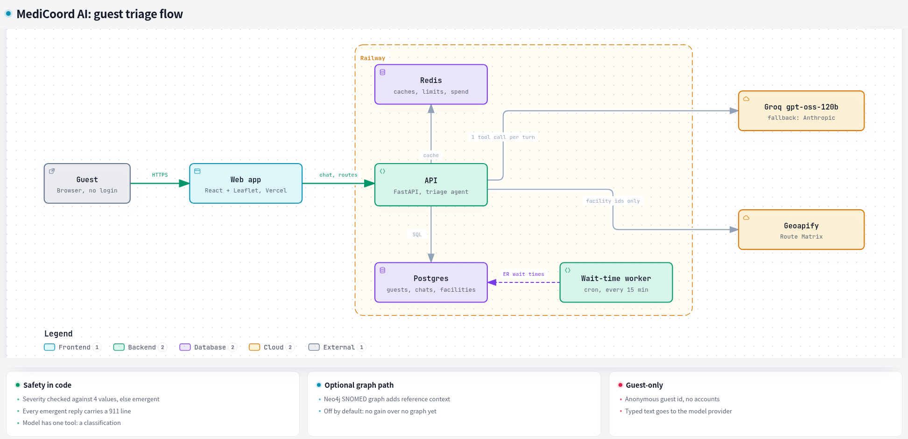

# MediCoord AI

**AI-powered health coordination: describe how you feel, get sent to the right care nearby.**

---

## What This Is

A person describes symptoms in plain language. The system asks follow-up questions when it needs them, classifies the severity (`routine`, `moderate`, `urgent` or `emergent`), picks the nearest appropriate facility, and shows the route on a live map. The chat explains why, in plain words, and every emergent answer tells the person to call 911.

It is a guest-only demo for Toronto: no account, no stored identity. Each browser gets an anonymous guest id.

It started as a 48-hour hackathon build (Toronto Tech Week 2025). The rebuild replaced the simulation with a working backend, a real chat flow and measured evidence. The hackathon code is archived in the repository.

---

## Current State (Sprint 23)

| Area | Status |
|---|---|
| Chat, severity classification, facility routing on a live map | Working, deployed |
| Guest demo (anonymous guest ids, feedback and event capture) | Working |
| LLM calls | Groq `gpt-oss-120b`, with Anthropic as fallback; per-provider circuit breaker, retries and a per-conversation token cap |
| Facility routing | Geoapify Route Matrix (car, bike, bus, walk) with load-aware ranking and ER wait times from a 15-minute worker |
| Graph-assisted triage (SNOMED knowledge graph) | Built and measured, **off by default**: it does not beat the no-graph path yet (see Symptom Understanding) |
| Load and scale | Measured to about 35 chat turns per second on one small instance (see Performance) |
| Security | Reviewed in Sprint 23, 3 High findings fixed (see Security) |
| Accounts, emergency-contact alerts, analytics, admin | Out of scope for this phase |

Full history: [CHANGELOG.md](CHANGELOG.md).

---

## How It Works



Safety rules in code, not in the prompt: the model's severity is validated against the four allowed values and fails toward `emergent`; every emergent reply carries a 911 line; the model has one tool and cannot fetch, send or run anything; routing takes facility ids only.

---

## Performance

Load-tested in Sprint 22 (2026-10-13) with k6 against the deployed API on a single
1 vCPU / 1 GB instance. LLM and routing calls ran through a provider mock calibrated
against 1,935 real OpenAI turns (mean 1.69 s and p95 within 2% of real).
Sprint details: [CHANGELOG.md](CHANGELOG.md) (Sprint 22).

| Result | Value |
|---|---|
| Throughput, one instance | ~35 chat turns/s (2,100/min), ~16 ms API CPU per turn |
| Admission control at 2.5x capacity | accepted turns p95 3.3 s (10.3 s without it); excess gets a fast retry-after answer |
| 60-minute soak | 93,322 turns, 0 failures, p95 2.6 s, memory flat (+0.2%) |
| Breakpoint run | 14,238 turns, 0 failures; past ~60 turns in flight it queues instead of failing |
| DB pool sizing | measured: pool 5 beats 10 and 20 on one vCPU (control run reproduced) |

Next: an async database pool and a 2-worker box, re-measured with the same ladder.

---

## Symptom Understanding

**Why this is measured.** The aim is a graph path that is clinically as good as the no-graph baseline (`off`), where the LLM alone decides. Relying on the LLM alone sends every user's symptom text to the model host, with no data processing agreement yet. Matching `off` on safety and on the questions asked is the condition for moving part of that work off the model. Not met today.

Method: 27 clinician-reviewed vignettes, 3 repeats, simulated patient (`claude-haiku-4-5`), scored in code against gold severity. Sprint 23 system under test: `gpt-oss-120b` on Ollama Cloud (August: Groq). Details: [CHANGELOG.md](CHANGELOG.md).

### 1. Retrieval

Does the graph find the right complaint? Gold anchor in the top 5 (top 1 in brackets). `off` retrieves nothing.

| Leg | August 2026 | Now (Sprint 23) |
|---|---|---|
| static lookup | 100% on 20 messages (top 1); 0 of 10 lay messages | not re-run |
| v2 graph | 35% on 20 messages (top 1); 0 of 10 lay messages | not re-run |
| v3 (BioLORD) | did not exist | 83 to 93% across four sets of 104 to 365 messages (top 1: 38 to 71%) |
| v3 (bge-small) | did not exist | 69 to 81% on the same four sets (top 1: 36 to 56%) |

The static 100% is a vocabulary artifact: its test messages were written from its own vocabulary. Substring matching scored 4% on the 150 author-written messages. v3 fixed lay-language matching; only its top 5 is reliable. BioLORD is the accuracy pick; bge-small is the likelier production pick on CPU, since in the ONNX bench it embeds a message in about 3 ms against 19 to 31 ms, uses about 115 MB of memory against about 600 MB, and its model file is 34 MB against 418 MB, but it misses the 75% hit@5 screen on all four sets, so it needs a retrieval-quality fix before it can ship.

### 2. Triage

Under-triage = a more severe case classified lower (lower is better). Accuracy in brackets. 81 conversations per leg.

| Leg | August (original wording, 1 run) | Now, original wording | Now, lay wording |
|---|---|---|---|
| `off` | 22.2% (63.0%) | 23.5% (69.1%) | 22.2% (69.1%) |
| static | 37.0% (51.9%) | 25.9% (66.7%) | 27.2% (64.2%) |
| v2 | 22.2% (66.7%) | removed | removed |
| v3 | n/a | 28.4% (65.4%) | 29.6% (64.2%) |

v3 is 7.4 points worse than `off` on the lay set (paired 95% interval [-14.8, -1.2], exact McNemar p = 0.25): no evidence it helps, not proof it harms. Re-running the lay set moved `off` by 5 points, so smaller gaps are noise.

### 3. Elicitation coverage

The goal: check whether the graph improves understanding (asking for the facts a clinician needs) even if overall triage does not improve. Share of checklist facts the patient voiced after the system's questions. Lay set, 81 conversations per leg, judge `gpt-4o-mini`. August: not measured.

| Leg | Patient-answerable facts (primary) | All facts |
|---|---|---|
| `off` | 35.5% | 24.0% |
| static | 33.9% | 23.9% |
| v3 | 32.6% | 24.2% |

v3 minus `off`: -2.9 points (95% interval [-11.7, +3.1]). All comparisons include zero: the graph does not elicit more needed facts. The second-judge check failed (misconfigured), so judge reliability is unproven; one run only.

### Reading

- Better matching did not make triage safer or the chat's questions better.
- Production keeps the no-graph path as default until v3 beats it beyond the paired interval.
- Open: whether the host matters (no Groq check was run), and why v3 misses some vignettes. Early reading: generic red flags plus patient "no" answers get used as reassurance, lowering severity (not yet quantified).

---

## Security

Sprint 23 review (2026-11-09 to 2026-11-12), run locally with free tools; the AI part used the production model (Groq `gpt-oss-120b`). Full report: [docs/security/2026-11-12-security-review.md](docs/security/2026-11-12-security-review.md).

| Area | Result |
|---|---|
| Secrets, dependencies, static analysis, ZAP scans | no secret in the tree; known advisories fixed or listed; 0 findings in app code; ZAP 0 FAIL |
| Guest isolation | 30 of 30 checks; no guest can read or change another guest's data |
| Red team (72 attacks, real model) | none lowered the severity or leaked the prompt; every emergent reply carried 911; 6 flagged, none High |
| Agent power | the model has one tool that returns a classification; it cannot fetch, send or run anything |

Three High findings were found and fixed with tests: a junk `Bearer` header could stall the API, the model's severity was not validated, and emergent replies could lack a 911 line. Open: typed personal details reach the model provider unredacted, and a reply can be replaced by attacker text (the severity and 911 line still hold). Limits: one run of a sample, not a proof; the semantic path and live graph were not tested.

---

## Tech Stack

- **Frontend:** React 18, Vite, TypeScript (strict), Tailwind CSS, React Leaflet
- **Backend:** Python 3.11, FastAPI, Pydantic
- **AI:** Groq (primary) and Anthropic (fallback), chosen by `LLM_PROVIDER` and `LLM_PROVIDER_CHAIN`
- **Routing:** Geoapify Route Matrix
- **Data:** Railway Postgres for the guest demo, Redis for caches, Neo4j Aura for the optional graph path; Supabase remains the legacy store
- **Config and secrets:** Doppler
- **Deploy:** Vercel (frontend), Railway (API and worker)
- **Evaluation:** a 27-vignette triage harness in `backend/scripts/symptom_eval/`

---

## Repository Structure

```
medicoordai/
|-- backend/      FastAPI API: routers, services, llm, graph, middleware; eval and security scripts
|-- webapp/       React + Vite + TypeScript app
|-- shared/       shared TypeScript types (severity schema, API contracts)
|-- workers/      ER wait-time scraper (Railway cron)
|-- migrations/   database migrations
|-- e2e/          end-to-end symptom-understanding check script
|-- docs/         architecture, API, specs, plans, security review
|-- pipeline/     analytics pipeline (dbt models, functions, infra)
`-- cloud_function/, fine_tuning_training/, backup/   archived hackathon code
```

Start with [docs/ARCHITECTURE.md](docs/ARCHITECTURE.md), [docs/API.md](docs/API.md) and [shared/types.ts](shared/types.ts). The severity values (`routine`, `moderate`, `urgent`, `emergent`) are defined once, in `shared/types.ts`.

---

## Status

Active development. The guest demo is live; the open questions are clinical (the graph path does not yet match the no-graph baseline) and the items listed under Security. `main` is protected; work goes through `preview`.
